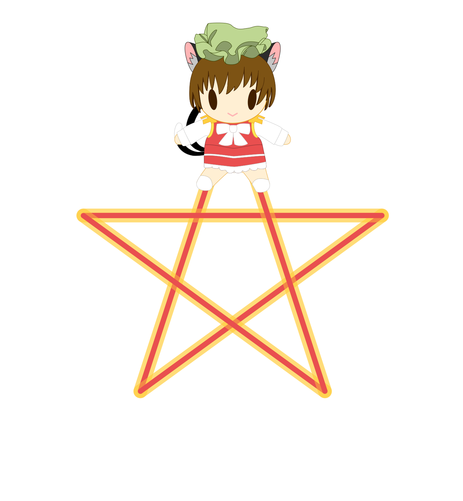
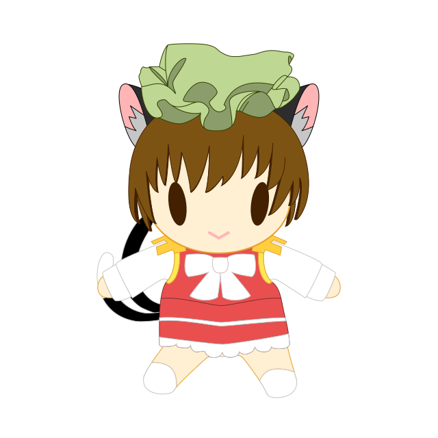
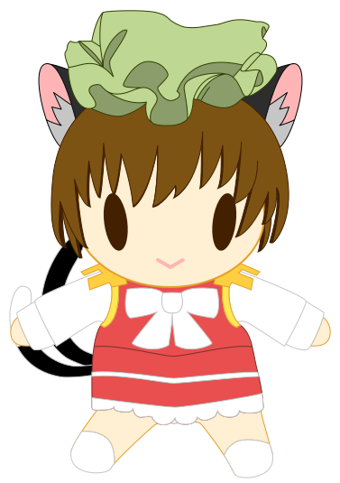
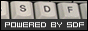
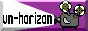
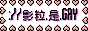

  
  
  
  
   
  
   
  

 

<table align="right">
  <tr>
    <td align="center" valign="middle">
      
    </td>
    <td align="center" valign="middle">
      
      
      
      
      
      
      
      
      
      
      
      
       
       
      
      &nbsp;
      
      &nbsp;
      
      &nbsp;
      
      &nbsp;
      
      &nbsp;
      
      &nbsp;
      
      &nbsp;
      
      &nbsp; 
      <kbd>cats in a box</kbd>
       
    </td>
  </tr>
</table>

  
  &nbsp;
  
  
  
  &nbsp;   
  
  &nbsp;
  
  &nbsp;
  
  &nbsp;
  
  &nbsp;

